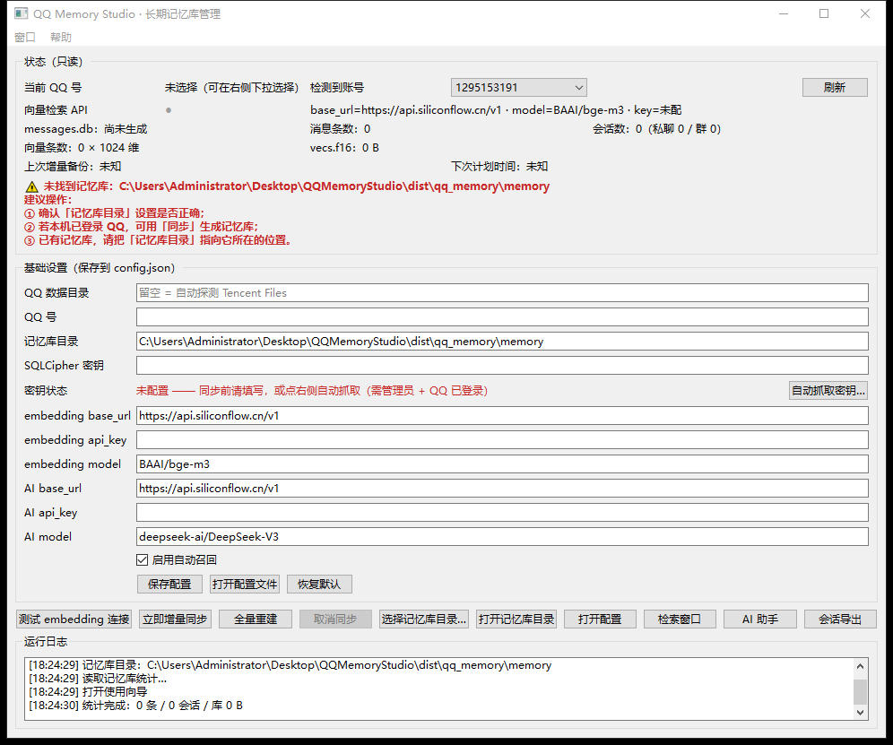

# QQ Memory Studio

> 一个独立的 Windows 桌面 GUI，用来管理**本机 QQ 长期记忆库**：把 QQ 的聊天记录解密、抽取、
> 建索引（关键词 + 语义向量），再提供可视化检索与 AI 问答。
> 不依赖 AstrBot，不改动你的 QQ 安装目录，也不动已有记忆库文件。

[](LICENSE)


## ✨ 功能

- **状态面板**（只读）：QQ 号自动探测（多账号下拉）、向量检索接口连通性、记忆库体积/消息数/会话数/向量数、上次增量备份与下次计划时间。
- **基础设置**：QQ 数据目录、SQLCipher 密钥、记忆库目录、embedding 与 AI 接口（base_url / api_key / model）、自动召回开关。配置写入 `config.json`，首次运行自动生成。
- **同步**：增量同步 / 全量重建，走**独立子进程**（可取消、崩溃隔离），运行日志实时输出。
- **向量库浏览与检索**：关键词 / 语义双模式；按会话、发送人、日期、只看我发的过滤；结果表可双击看全文、复制正文、导出 CSV。
- **AI 检索助手**：自然语言提问，AI 调用 `search_memory` 工具检索记忆库作答，右侧列出引用原文并可定位。
- **前置校验与友好引导**：缺密钥 / 找不到 `nt_msg.db` 时只在状态区给中文原因和下一步动作，不弹模态框、不卡死窗口。

## 🖼 界面预览



> 上图：主窗口（状态面板 / 基础设置 / 操作按钮 / 运行日志）

## 📁 目录结构

```
.
├── LICENSE
├── dist/                    # 构建好的便携版
│   ├── QQMemoryStudio.exe   # 单文件 exe（约 70 MB）
│   └── 使用说明.txt
└── qq_memory_studio/        # 源码
    ├── app.py               # 入口：python app.py
    ├── ui/                  # 主窗口 / 检索窗口 / AI 助手 / 导出窗口 / 后台线程
    ├── core/                # 配置、记忆库查询、语义检索、同步、AI、QQ 探测
    ├── pipeline/            # 随包提供的干净版数据流水线（解密 / 抽取 / 建索引 / 向量化）
    ├── scripts/             # 打包与预览脚本
    ├── build_exe.ps1        # PyInstaller 一键打包
    └── requirements.txt
```

## 🚀 运行（源码方式）

```powershell
python -m pip install -r .\qq_memory_studio\requirements.txt
python .\qq_memory_studio\app.py
```

依赖：Python 3.10+、PySide6；同步/检索链路另需 numpy、sqlcipher3、protobuf（打包版已内置）。

## 📦 打包 exe

```powershell
powershell -ExecutionPolicy Bypass -File .\qq_memory_studio\build_exe.ps1
# 单文件模式
powershell -ExecutionPolicy Bypass -File .\qq_memory_studio\build_exe.ps1 -OneFile
```

产物在 `dist\QQMemoryStudio\`。脚本会自动装 PyInstaller、带 `--noconsole`，并把整条 `pipeline`
以 `--add-data` 打进包里。

## ⚠️ 已知限制

- 同步需要 **SQLCipher 密钥** + 已登录的 QQ 与 `nt_msg.db`；密钥不通过命令行传递，只走环境变量 `QQMEM_DB_KEY`。
- AI 助手需要 **OpenAI 兼容且支持 function calling** 的模型。
- 语义检索需要 embedding 接口；未配置时自动退回关键词检索。

## 🔐 隐私说明

本工具只在你本机处理数据：所有解密、抽取、向量化都在本地完成，`messages.db` / `vecs.f16` 由你自己保管。
配置文件 `config.json`（含你的接口密钥）已被 `.gitignore` 排除，请勿提交到版本库。

## 📄 许可证

本项目采用 **MIT License**，版权归 **姜黄** 所有，详见 [LICENSE](LICENSE)。
